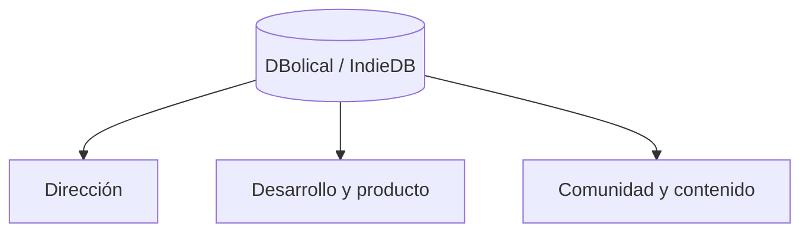

# 01 · Análisis y documentación inicial (RA1)

> **Plantilla.** Se entrega como **H1 el 26-nov-2026**. Cada apartado indica el criterio de evaluación (CE) que evidencia y qué se espera. Borra las notas en cursiva al rellenar.

## 1. Sector y empresas (CE 1a, 1b)

### Empresas del sector analizadas

| # | Empresa | Producto o servicio | Características organizativas |
|---|---|---|---|
| 1 | **Valve** (Steam) | Distribución de videojuegos y comunidad/noticias (*Events & Announcements*, RSS por juego) | Grande empresa de capital privado; estructura organizativa consolidada; operación vertical integrada (desarrollo, publicación y distribución) |
| 2 | **The itch.io Team** | Marketplace y *devlogs* para desarrolladores independientes | Organización pequeña/mediana, centrada en creators independientes |
| 3 | **DBolical** (IndieDB) | Plataforma de información y seguimiento de estudios indie (perfiles de juegos, noticias, galería, video, descargas, foros) | Pyme australiana; especializada en videojuegos independientes |
| 4 | **Reddit** | Comunidad de desarrollo de videojuegos | Red social con comunidades temáticas |
| 5 | **X Corp.** | Red social de publicación y seguimiento de desarrolladores de videojuegos | Red social global |
| 6 | **Game Jolt** | Comunidad y *devlogs* de videojuegos | Comunidad social gaming |

### Empresa tipo: DBolical (IndieDB)

**DBolical** es la empresa tipo de este documento porque su producto se acerca más a la propuesta de GameFeeds: una plataforma dedicada a centralizar la información sobre videojuegos independientes y a darla de ver a su audiencia.

**Organigrama** (diagrama Mermaid):

**Funciones de cada departamento:**

- **Dirección**: estrategia, negocio y finanzas de la plataforma.
- **Desarrollo y producto**: construcción y evolución de los perfiles de juegos, noticias, galería, video, descargas y foros.
- **Comunidad y contenido**: publicación y gestión de noticias, soporte a desarrolladores y comunidad.

## 2. Necesidades y oportunidades (CE 1c, 1d)

### Necesidades más demandadas

| ID | Necesidad | Prioridad | Criterio de priorización | Fuente |
|----|-----------|-----------|--------------------------|--------|
| N-01 | Tener una forma centralizada de conocer las fuentes de información sobre el desarrollo de un videojuego o de un desarrollador, y de seguir su evolución | Must | Necesidad real detectada en el documento de inicio; ninguna de las soluciones del SOTA cubre el seguimiento por intereses del usuario | Documento de inicio y SOTA ([`01b-sota.md`](01b-sota.md)) |
| N-02 | Que los desarrolladores independientes dispongan de una fuente unificada para publicar su progreso | Must | Necesidad detectada en el sector; parcialmente atendida por soluciones del SOTA (Steam, *itch.io*, IndieDB) | Estudio SOTA ([`01b-sota.md`](01b-sota.md)) |
| N-03 | Que los usuarios puedan guardar juegos y desarrolladores de interés y gestionar las fuentes asociadas | Must | Funcionalidad definida como imprescindible en el documento de inicio | Documento de inicio |

### Criterio de priorización

Se priorizan las necesidades con el criterio **MoSCoW** (Must / Should / Could), complementado con el **impacto sobre el usuario objetivo** y la **urgencia de uso**. Una necesidad queda en *Must* cuando supone el núcleo del problema que se quiere resolver con el proyecto; pasa a *Should* cuando es importante pero no imprescindible para la versión mínima.

### Oportunidad de negocio

El sector de los videojuegos independientes ofrece una oportunidad de negocio previsible: según datos publicados por IndieDB, el ecosistema cuenta con más de **3.000.000 de desarrolladores independientes** y un público de más de **3.000.000 de jugadores mensuales** interesados en seguir el desarrollo de los juegos. Fuente: [IndieDB](https://www.indiedb.com/about) (acceso: 17-nov-2026).

## 3. Tipo de proyecto elegido (CE 1e)

### Proyecto propuesto

**GameFeeds** se propone como respuesta a la necesidad de centralizar las fuentes de información sobre el desarrollo de videojuegos y de los desarrolladores independientes.

### Justificación frente a alternativas

- **Alternativa 1 – Centralizar en una plataforma existente** (Steam, *itch.io*, IndieDB): se descarta porque ninguna cubre de forma completa el problema: no permite gestionar fuentes de desarrollo no centralizadas (X/Twitter, RSS personales, newsletters) ni seguir intereses específicos del usuario.
- **Alternativa 2 – Usar agregadores de RSS** (Feedly, Inoreader): se descarta porque no ofrecen gestión de fuentes por juego/desarrollador ni seguimiento personalizado.
- **Alternativa 3 – Mantener las fuentes dispersas**: se descarta por la necesidad real detectada en el documento de inicio.

### Conclusión

GameFeeds adopta el tipo de proyecto de **aplicación web de seguimiento y agregación de fuentes de información sobre videojuegos**.

## 4. Requisitos y restricciones (CE 1f)

### Requisitos

| ID | Requisito | Tipo (funcional / no funcional / restricción) | Cómo se verifica |
|---|---|---|---|
| RF-01 | El sistema debe permitir listar los videojuegos con sus fuentes de información asociadas | funcional | Prueba: listado de videojuegos y sus fuentes en la respuesta |
| RF-02 | El sistema debe permitir guardar y visualizar las fuentes de información de un videojuego | funcional | Prueba: alta de fuente y visualización |
| RF-03 | El sistema debe permitir registrar cambios sobre las fuentes de un videojuego | funcional | Prueba: registro de cambios |
| RNF-01 | El sistema debe responder el listado y la consulta de fuentes en menos de 2 s | no funcional | Prueba de rendimiento |
| RNF-02 | Las contraseñas de los usuarios deben almacenarse con hash y gestionarse de forma segura | no funcional | Auditoría / prueba de seguridad |
| REST-01 | El proyecto se desarrollará con Java 21, Spring Boot, MySQL y Docker, en el plazo del H1 | restricción | Verificación durante el desarrollo |

### Matriz de trazabilidad

| Objetivo | Requisito | Caso de uso | Pantalla o endpoint | Prueba o indicador |
|---|---|---|---|---|
| OBJ-01 Gestionar fuentes de videojuegos | RF-01 | | | pendiente |

## 5. Obligaciones fiscales, laborales y de prevención (CE 1g)

### Obligaciones aplicables

- **Fiscal**: No procede ninguna obligación fiscal, al tratarse el proyecto de una actividad personal sin ánimo de lucro desarrollada en el marco del TFG.
- **Laboral**: No procede obligación laboral, al no existir relación laboral con los usuarios ni con terceros.
- **Prevención**: Aplica la normativa de prevención de riesgos laborales (Ley 31/1995) en el ámbito en que se realice la actividad.

### Condiciones

- Al no usarse datos personales reales en el proyecto, no se considera aplicable el tratamiento de datos personales en esta fase.

## 6. Ayudas y subvenciones (CE 1h)

### Ayudas identificadas

- **Creative Europe – MEDIA** (Unión Europea): ayuda del programa marco de la UE para los medios audiovisuales, del que forman parte los agentes e industrias del sector del videojuego. Fuente: [Creative Europe – MEDIA](https://creative-europe.ec.europa.eu/). Requisitos: presentación de propuestas de proyectos culturales e industriales. Plazo: convocatorias anuales (por concretar).

### Estado

- Pendiente de confirmar con el tutor la ayuda concreta que se priorizará para el proyecto en esta fase.

## 7. Guion de trabajo (CE 1i)

### Fases y hitos

- **Fase 1 – Documentación inicial (RA1)**: elaboración de secciones 1 a 8 del presente documento y del `00-documentoInicio.md`. Hasta el **26-11-2026** (H1).
- **Fase 2 – Estado del arte (SOTA)**: apartados 1, 2 y 5 del [`01b-sota.md`](01b-sota.md). Hasta el **25-11-2026**.
- **Fase 3 – Desarrollo mínimo**: implementación de la versión mínima con las funcionalidades definidas como imprescindibles.

### Responsables

- **Marcos González García** (alumno responsable del proyecto).

### Seguimiento

- **Repositorio de GitHub** – [proyecto-daw-marcos-gonzalez](https://github.com/Endaah/proyecto-daw-marcos-gonzalez.git)

## 8. Glosario

### Términos del dominio

| Término | Definición | Sinónimos que NO uso |
|---|---|---|
| Devlog | Publicación periódica o puntual de actualizaciones sobre el desarrollo de un videojuego | Bitácora, changelog, post de desarrollo |
| RSS | Formato de sindicación de contenido que permite suscribirse a fuentes de información | Feed, agregador |
| Videojuego independiente | Videojuego desarrollado por un estudio pequeño o individual, sin estructura corporativa de gran tamaño | Indie, estudio emergente |

### Términos del proyecto

| Término | Definición | Sinónimos que NO uso |
|---|---|---|
| Fuente | Origen de información (plataforma, red social, RSS, newsletter) sobre un videojuego o desarrollador | Medio, canal |
| Seguimiento | Acción de mantenerse informado sobre un videojuego o desarrollador mediante el uso de fuentes | Tracking, watch |

---

## Criterios de evaluación de este documento (RA1, texto literal)

- **1a)** Se han clasificado las empresas del sector por sus características organizativas y el tipo de producto o servicio que ofrecen.
- **1b)** Se han caracterizado las empresas tipo indicando la estructura organizativa y las funciones de cada departamento.
- **1c)** Se han identificado las necesidades más demandadas a las empresas.
- **1d)** Se han valorado las oportunidades de negocio previsibles en el sector.
- **1e)** Se ha identificado el tipo de proyecto requerido para dar respuesta a las demandas previstas.
- **1f)** Se han determinado las características específicas requeridas al proyecto.
- **1g)** Se han determinado las obligaciones fiscales, laborales y de prevención de riesgos y sus condiciones de aplicación.
- **1h)** Se han identificado posibles ayudas o subvenciones para la incorporación de nuevas tecnologías de producción o de servicio que se proponen.
- **1i)** Se ha elaborado el guión de trabajo que se va a seguir para la elaboración del proyecto.
