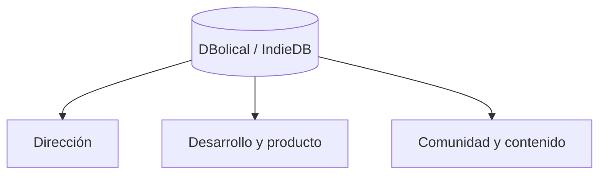

# 01 · Análisis y documentación inicial (RA1)

> **Plantilla.** Se entrega como **H1 el 26-nov-2026**. Cada apartado indica el criterio de evaluación (CE) que evidencia y qué se espera. Borra las notas en cursiva al rellenar.

## 1. Sector y empresas (CE 1a, 1b)

### Empresas del sector analizadas

| # | Empresa | Producto o servicio | Características organizativas |
|---|---|---|---|
| 1 | **Valve** (Steam) | Distribución de videojuegos y comunidad/noticias (*Events & Announcements*, RSS por juego) | Grande empresa de capital privado; estructura organizativa consolidada; operación vertical integrada (desarrollo, publicación y distribución) |
| 2 | **The itch.io Team** | Marketplace y *devlogs* para desarrolladores independientes | Organización pequeña/mediana, centrada en creators independientes |
| 3 | **DBolical** (IndieDB) | Plataforma de información y seguimiento de estudios indie (perfiles de juegos, noticias, galería, video, descargas, foros) | Pyme australiana; especializada en videojuegos independientes |
| 4 | **Reddit** | Comunidad de desarrollo de videojuegos | Red social con comunidades temáticas |
| 5 | **X Corp.** | Red social de publicación y seguimiento de desarrolladores de videojuegos | Red social global |
| 6 | **Game Jolt** | Comunidad y *devlogs* de videojuegos | Comunidad social gaming |

### Empresa tipo: DBolical (IndieDB)

**DBolical** es la empresa tipo de este documento porque su producto se acerca más a la propuesta de GameFeeds: una plataforma dedicada a centralizar la información sobre videojuegos independientes y a darla de ver a su audiencia.

**Organigrama** (diagrama Mermaid):

**Funciones de cada departamento:**

- **Dirección**: estrategia, negocio y finanzas de la plataforma.
- **Desarrollo y producto**: construcción y evolución de los perfiles de juegos, noticias, galería, video, descargas y foros.
- **Comunidad y contenido**: publicación y gestión de noticias, soporte a desarrolladores y comunidad.

## 2. Necesidades y oportunidades (CE 1c, 1d)

### Necesidades más demandadas

| ID | Necesidad | Prioridad | Criterio de priorización | Fuente |
|----|-----------|-----------|--------------------------|--------|
| N-01 | Tener una forma centralizada de conocer las fuentes de información sobre el desarrollo de un videojuego o de un desarrollador, y de seguir su evolución | Must | Necesidad real detectada en el documento de inicio; ninguna de las soluciones del SOTA cubre el seguimiento por intereses del usuario | Documento de inicio y SOTA ([`01b-sota.md`](01b-sota.md)) |
| N-02 | Que los desarrolladores independientes dispongan de una fuente unificada para publicar su progreso | Must | Necesidad detectada en el sector; parcialmente atendida por soluciones del SOTA (Steam, *itch.io*, IndieDB) | Estudio SOTA ([`01b-sota.md`](01b-sota.md)) |
| N-03 | Que los usuarios puedan guardar juegos y desarrolladores de interés y gestionar las fuentes asociadas | Must | Funcionalidad definida como imprescindible en el documento de inicio | Documento de inicio |

### Criterio de priorización

Se priorizan las necesidades con el criterio **MoSCoW** (Must / Should / Could), complementado con el **impacto sobre el usuario objetivo** y la **urgencia de uso**. Una necesidad queda en *Must* cuando supone el núcleo del problema que se quiere resolver con el proyecto; pasa a *Should* cuando es importante pero no imprescindible para la versión mínima.

### Oportunidad de negocio

El sector de los videojuegos independientes ofrece una oportunidad de negocio previsible: según datos publicados por IndieDB, el ecosistema cuenta con más de **3.000.000 de desarrolladores independientes** y un público de más de **3.000.000 de jugadores mensuales** interesados en seguir el desarrollo de los juegos. Fuente: [IndieDB](https://www.indiedb.com/about) (acceso: 17-nov-2026).

## 3. Tipo de proyecto elegido (CE 1e)

### Proyecto propuesto

**GameFeeds** se propone como respuesta a la necesidad de centralizar las fuentes de información sobre el desarrollo de videojuegos y de los desarrolladores independientes.

### Justificación frente a alternativas

- **Alternativa 1 – Centralizar en una plataforma existente** (Steam, *itch.io*, IndieDB): se descarta porque ninguna cubre de forma completa el problema: no permite gestionar fuentes de desarrollo no centralizadas (X/Twitter, RSS personales, newsletters) ni seguir intereses específicos del usuario.
- **Alternativa 2 – Usar agregadores de RSS** (Feedly, Inoreader): se descarta porque no ofrecen gestión de fuentes por juego/desarrollador ni seguimiento personalizado.
- **Alternativa 3 – Mantener las fuentes dispersas**: se descarta por la necesidad real detectada en el documento de inicio.

### Conclusión

GameFeeds adopta el tipo de proyecto de **aplicación web de seguimiento y agregación de fuentes de información sobre videojuegos**.

## 4. Requisitos y restricciones (CE 1f)

### Objetivos

- **OBJ-01** · Juntar al menos 10 (valor provisional) fuentes de información generales en un sitio centralizado para usuarios interesados en videojuegos, medido con la cantidad de fuentes recopiladas en el sitio web.
- **OBJ-02** · Permitir que cada usuario guarde hasta 20 (valor provisional, 20 en total entre juegos y desarrolladores) juegos y desarrolladores en los que estén interesados, medido con una prueba que compruebe que se rechaza el número 21.
- **OBJ-03** · Mostrar al menos 1 aviso en la página cuando cambia una fuente, medido con una prueba que comprueba que ha aparecido un aviso al modificar una fuente.
- **OBJ-04** · Guardar al menos 1 fuente de información ligada a un videojuego específico, medido por una prueba que añada una fuente de información al perfil de un videojuego y compruebe que se ha añadido.

### Requisitos

| ID | Requisito | Tipo (funcional / no funcional / restricción) | Cómo se verifica |
|---|---|---|---|
| RF-01 | El sistema debe permitir listar los videojuegos con sus fuentes de información asociadas | funcional | Prueba: listado de videojuegos y sus fuentes en la respuesta |
| RF-02 | El sistema debe permitir guardar y visualizar las fuentes de información de un videojuego | funcional | Prueba: alta de fuente y visualización |
| RF-03 | El sistema debe permitir registrar cambios sobre las fuentes de un videojuego | funcional | Prueba: registro de cambios |
| RF-04 | El sistema debe permitir que el usuario registre videojuegos y desarrolladores en los que estén interesados | funcional | Prueba: registrar un juego y comprobar que aparece en la lista; registrar un desarrollador y comprobar que aparece en la lista |
| RNF-01 | El sistema debe responder el listado y la consulta de fuentes en menos de 2 s | no funcional | Prueba de rendimiento |
| RNF-02 | Las contraseñas de los usuarios deben almacenarse con hash y gestionarse de forma segura | no funcional | Auditoría / prueba de seguridad |
| REST-01 | El proyecto se desarrollará con Java 21, Spring Boot, MySQL y Docker, en el plazo del H1 | restricción | Verificación durante el desarrollo |

### Matriz de trazabilidad

| Objetivo | Requisito | Caso de uso | Pantalla o endpoint | Prueba o indicador |
|---|---|---|---|---|
| OBJ-01 | RF-01 | pendiente | pendiente | pendiente |
| OBJ-01 | RNF-01 | pendiente | pendiente | pendiente |
| OBJ-02 | RF-04 | pendiente | pendiente | pendiente |
| OBJ-02 | RNF-02 | pendiente | pendiente | pendiente |
| OBJ-03 | RF-03 | pendiente | pendiente | pendiente |
| OBJ-04 | RF-01 | pendiente | pendiente | pendiente |
| OBJ-04 | RF-02 | pendiente | pendiente | pendiente |

## 5. Obligaciones fiscales, laborales y de prevención (CE 1g)

### A quién afecta el proyecto

Servicio **solo en línea**, explotado por un **autónomo sin personal contratado** y **sin ánimo de lucro**. Guarda datos de usuarios (correo, contraseña y nombre de usuario).

### Obligaciones aplicables

| Obligación | Por qué le toca | Norma (con enlace) | Estado |
|---|---|---|---|
| **Fiscal**: alta en el Censo de Empresarios, Profesionales y Retenedores | Es un servicio en línea, pero sin ingresos. La AEAT incluye en ese censo a quien desarrolle actividades empresariales o profesionales: si no hay actividad económica, no procede el alta | [RD 1065/2007](https://www.boe.es/buscar/act.php?id=BOE-A-2007-15984) y [Ley 58/2003](https://www.boe.es/buscar/act.php?id=BOE-A-2003-23186); página [Censo de empresarios, profesionales y retenedores](https://sede.agenciatributaria.gob.es/Sede/censos-nif-domicilio-fiscal/quien-debe-estar-censado/censo-empresarios-profesionales-retenedores.html) | leído, 2026-11-24 |
| **Laboral**: alta y cotización en el RETA | Autónomo sin personal. Solo hay obligación si se realiza una actividad económica a título lucrativo; sin ingresos, no procede el alta | [Ley 20/2007](https://www.boe.es/buscar/act.php?id=BOE-A-2007-13409) y [página Trabajo Autónomo de la Seguridad Social](https://portal.seg-social.gob.es/wps/portal/importass/importass/Colectivos/Trabajo+Autonomo) | ley: sin leer; página: leído, 2026-11-24 |
| **Prevención**: trabajo con pantallas de visualización | Se desarrolla delante de una pantalla, pero la norma impone obligaciones al empresario respecto de sus trabajadores y no hay personal contratado: no aplica | [RD 488/1997](https://www.boe.es/buscar/act.php?id=BOE-A-1997-8671) | leído en parte, 2026-11-24 |
| **Protección de datos**: datos de los usuarios | Guarda correo, contraseña y nombre de usuario, que son datos personales | [RGPD](https://www.boe.es/buscar/doc.php?id=DOUE-L-2016-80807) y [LOPDGDD](https://www.boe.es/buscar/act.php?id=BOE-A-2018-16673) | sin leer |

### Lo que no pude comprobar

- Si, sin ingresos, existe **actividad económica** a efectos de alta censal y de RETA. Queda pendiente de confirmar con la Agencia Tributaria o con el tutor.
- Si un **autónomo sin trabajadores** queda dentro del ámbito del RD 488/1997. Se ha decidido «no aplica», pero es una interpretación, no un dato comprobado.
- Si el **alojamiento web** que se use implica un encargado del tratamiento de datos. No se ha mirado.

## 6. Ayudas y subvenciones (CE 1h)

### Ayuda identificada

**Programa Cheques de Innovación y Desarrollo Empresarial — línea «Digitalización de la empresa» (convocatoria 2026)**. Agencia SEKUENS / IDEPA, Principado de Asturias.

| Dato | Contenido |
|---|---|
| **Quién puede pedirla** | Pymes y autónomos con **centro de trabajo en Asturias** donde desarrollen su actividad económica. El personal computado debe figurar en una **cuenta de cotización de la Seguridad Social registrada en Asturias**; el autónomo puede computarse a sí mismo. |
| **Qué cubre** | Digitalización de la empresa: proyectos viables técnica, económica y financieramente, iniciados **después** de la solicitud. Presupuesto máximo por proyecto: **15.000 €**. No cubre proyectos iniciados antes de pedir la ayuda. Los pagos deben respetar la Ley 3/2004 de morosidad. |
| **Cuánto** | Importe fijo. Para **empresario individual**, línea Digitalización: **1.250 €** si el proyecto está entre 2.500 € y menos de 5.000 €; **2.500 €** si está entre 5.000 € y 15.000 €. |
| **Plazo** | Hasta las **14:00 h del 30 de abril de 2026** (hora peninsular). |
| **Cómo se solicita** | Sede electrónica de SEKUENS / IDEPA, con el formulario, los datos generales, la **Memoria del proyecto** (no subsanable) y la declaración DACI. Máximo **una solicitud por línea**. |
| **Estado** | **Cerrada** (convocatoria 2026). |
| **Enlace** | [Ficha oficial IDEPA](https://www.idepa.es/detalle-ayuda/-/asset_publisher/EorU9gEBOv3g/content/ayuda-sekuens-ayudas-a-empresas-del-principado-de-asturias-en-el-marco-del-programa-cheques-de-innovacion-y-desarrollo-empresarial) |

### Lo que no pude comprobar

- Si GameFeeds encaja en alguno de los **sectores incluidos** en el Anexo B (industrial, servicios de apoyo industrial, construcción, comercio al por mayor, turismo).
- Hoy **no se cumple** el requisito de actividad económica ni el de alta y cotización en Asturias, porque el proyecto no genera ingresos. La ayuda se documenta como referencia, no como algo solicitable en este momento.
- Los datos se han tomado de la ficha oficial del IDEPA (actualizada el 22/04/2026). **No se ha podido abrir el PDF** de la convocatoria con las herramientas disponibles.

## 7. Guion de trabajo (CE 1i)

### Fases, tareas e hitos

| Fase | Fechas | Tareas principales | Responsable | Hito |
|---|---|---|---|---|
| 1 Análisis | 6-nov a 26-nov-2026 | Rellenar `docs/00-documentoInicio.md` · Rellenar `docs/01-analisis.md` · Empezar `docs/01b-sota.md` | Alumno | **H1** 26-nov-2026 |
| 2 Diseño | 26-nov a 10-dic-2026 | Diseñar la base de datos · Empezar a diseñar la infraestructura del backend · Diseñar la pantalla de muestra de fuentes | Alumno | — |
| 3 Planificación | 10-dic-2026 a 21-ene-2027 | Cerrar los requisitos · Completar el SOTA · Repartir el trabajo en el calendario | Alumno | **H2** 21-ene-2027 |
| 4 Implementación | 21-ene a 31-mar-2027 | Crear la base de datos · Crear una interfaz web básica inicial · Implementar una primera versión de la API | Alumno | — |
| 5 Pruebas | 1-abr a 23-abr-2027 | Crear pruebas para el CRUD de la base de datos · Comprobar que se listan los videojuegos y sus fuentes en la página · Probar que se pueden añadir y gestionar usuarios | Alumno | — |
| 6 Despliegue | 26-abr a 7-may-2027 | Determinar qué servicio de hosting usaré para alojar la app · Crear los archivos necesarios para Docker · Subir los archivos y desplegar la aplicación | Alumno | **H3** 7-may-2027 |
| 7 Seguimiento, control y cierre | 11-feb a 18-jun-2027 | Revisar el avance · Corregir el rumbo · Cerrar la documentación | Alumno | — |

### Responsables

- **Alumno** (responsable del proyecto): ejecuta las tareas de todas las fases.

### Seguimiento

- **Repositorio de GitHub** – [proyecto-daw-marcos-gonzalez](https://github.com/Endaah/proyecto-daw-marcos-gonzalez.git)

## 8. Glosario

### Términos del dominio y del proyecto

| Término | Definición | Sinónimos que NO uso |
|---|---|---|
| Devlog | Publicación periódica o puntual de actualizaciones sobre el desarrollo de un videojuego | Bitácora, changelog, post de desarrollo |
| RSS | Formato de sindicación de contenido que permite suscribirse a fuentes de información | Feed, agregador |
| Videojuego independiente | Videojuego desarrollado por un estudio pequeño o individual, sin estructura corporativa de gran tamaño | Indie, estudio emergente |
| Fuente | Origen de información (plataforma, red social, RSS, newsletter) sobre un videojuego o desarrollador | Medio, canal |
| Seguimiento | Acción de mantenerse informado sobre un videojuego o desarrollador mediante el uso de fuentes | Tracking, watch |

---

## Criterios de evaluación de este documento (RA1, texto literal)

- **1a)** Se han clasificado las empresas del sector por sus características organizativas y el tipo de producto o servicio que ofrecen.
- **1b)** Se han caracterizado las empresas tipo indicando la estructura organizativa y las funciones de cada departamento.
- **1c)** Se han identificado las necesidades más demandadas a las empresas.
- **1d)** Se han valorado las oportunidades de negocio previsibles en el sector.
- **1e)** Se ha identificado el tipo de proyecto requerido para dar respuesta a las demandas previstas.
- **1f)** Se han determinado las características específicas requeridas al proyecto.
- **1g)** Se han determinado las obligaciones fiscales, laborales y de prevención de riesgos y sus condiciones de aplicación.
- **1h)** Se han identificado posibles ayudas o subvenciones para la incorporación de nuevas tecnologías de producción o de servicio que se proponen.
- **1i)** Se ha elaborado el guión de trabajo que se va a seguir para la elaboración del proyecto.
